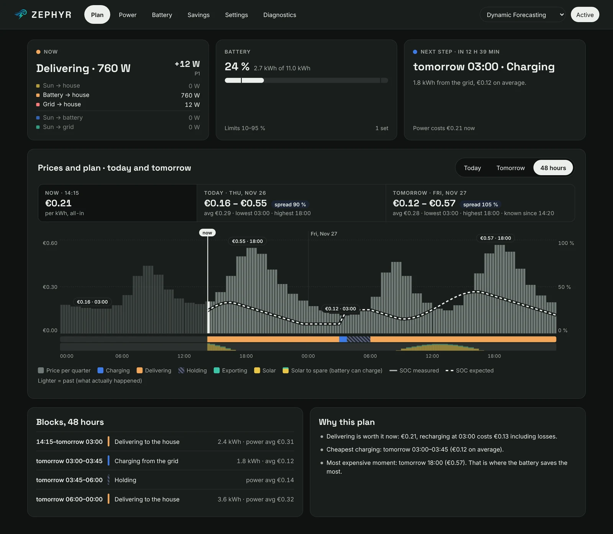

  <picture>
    <source media="(prefers-color-scheme: dark)" srcset="docs/logo-dark.png">
    
  </picture>

# ZEPHYR

*Zendure Energy Planning, Home Yield & Regulation*  
**Forecasting Tomorrow. Planning Today.**

[Nederlands](README.nl.md)

**ZEPHYR** is a Home Assistant integration (HACS) for Zendure home batteries. It talks to your Zendure set directly on your own network (the local zenSDK API, no cloud), keeps your grid meter at zero, and plans per quarter hour when the battery should charge, hold or deliver, based on dynamic energy prices, the solar forecast and what your house usually uses.

*The Plan screen (example data): what the battery does now, the prices for today and tomorrow, the planned charge level, and in plain language why this is the plan. Here ZEPHYR delivers to the house through the expensive evening, charges from the grid in the cheapest quarters of the night, and covers the morning and evening peaks of the next day.*

> **Status: in development.** ZEPHYR works and is being tested on real installations, but is not finished. Expect changes. See the [CHANGELOG](CHANGELOG.md) for what changed.

## What it does

**Controls the battery**
- **Zero on the meter:** follows your P1 meter and lets the battery charge with surplus solar and deliver what the house uses, so as little as possible goes to or comes from the grid.
- **Dynamic Forecasting:** the same control, steered by a plan. ZEPHYR decides per quarter hour whether to charge (from solar or from the grid), hold the charge for later, or deliver.
- Also **Standby**, **Fast charge** and **Fast discharge**.
- **Shadow mode:** ZEPHYR can first run alongside your current system and only calculate what it would do, without controlling the battery. Live control is one switch.
- **Safety first:** when in doubt (no meter data, set offline, another system controlling the set) ZEPHYR goes to 0 W. When Home Assistant stops, the battery goes to 0 W first.

**Plans ahead**
- Uses the day-ahead prices (Nord Pool) for today and, once known, tomorrow; optionally a price forecast for the days after.
- Uses your solar forecast (Solcast or the forecast of the Energy dashboard).
- Learns your household consumption per quarter hour, for workdays, weekends and holidays.
- Charges from the grid only when that is cheaper than waiting, including round-trip losses and battery wear.
- Takes into account loads you don't want to run on the battery (such as heating with an air conditioner), appliances you plan (washing machine, dryer, dishwasher), a vacation mode, and negative export prices (it can limit your solar inverter then).

**Shows and explains**
- Its own panel in the Home Assistant sidebar: **Plan**, **Power** (live power flows through your house), **Battery** (state of charge, cells, what the battery did per day), **Savings**, **Settings** and **Diagnostics**. Dutch and English, light and dark.
- Keeps a cost log per quarter hour: what you paid, and what you would have paid without battery or without solar.
- Keeps its own energy counters for the battery, with gaps detected and filled.

## Installation
1. In HACS: *Custom repositories* → add `https://github.com/cardinal808/ZEPHYR` as type *Integration*, then install **ZEPHYR**.
2. Restart Home Assistant.
3. Your set is usually found automatically (*Settings → Devices & services*). Otherwise add **ZEPHYR** and enter the IP address of the set.
4. Open the **ZEPHYR** panel in the sidebar → *Settings* and choose your P1 meter, price source and solar forecast (suggestions are shown). ZEPHYR starts in shadow mode.

Requirements: HEMS turned off in the Zendure app; Home Assistant 2026.1 or newer.

## Supported sets and batteries
- Sets with the local zenSDK API: SolarFlow 800, 800 Plus, 800 Pro, 1600 AC+, 2400 AC, 2400 AC+, 2400 Pro and 4000 AC+. Tested so far: 2400 Pro and 2400 AC+.
- Batteries are recognised by their serial number: AB1000, AB1000S, AB2000(S/X), AB3000X, AB3000L and the built-in batteries of the 2400 Pro, 2400 AC+, 4000 AC+ and AIO 2400.
- Newer models (800 AC+, 800 Pro 2, 3000/4000 Mix) and batteries (AB2000L, AB3000S, B6400) probably work for reading, but are not in the tables yet; a diagnostics download lets us add them.
- **Not supported** (no local zenSDK API): SolarFlow Hub 1200/2000, Hyper 2000, Ace 1500, AIO 2400 and SuperBase.
- Battery not recognised? Home Assistant shows a repair notice. Enter the capacity via ZEPHYR → the set → *Reconfigure*, and please open an issue with the line from the notice.

## Origin
ZEPHYR is a new implementation. It contains no code or text from other Zendure integrations or packages. Where other projects were consulted, only their behaviour was compared, after our own specification was written.

## License
MIT, see [LICENSE](LICENSE).
