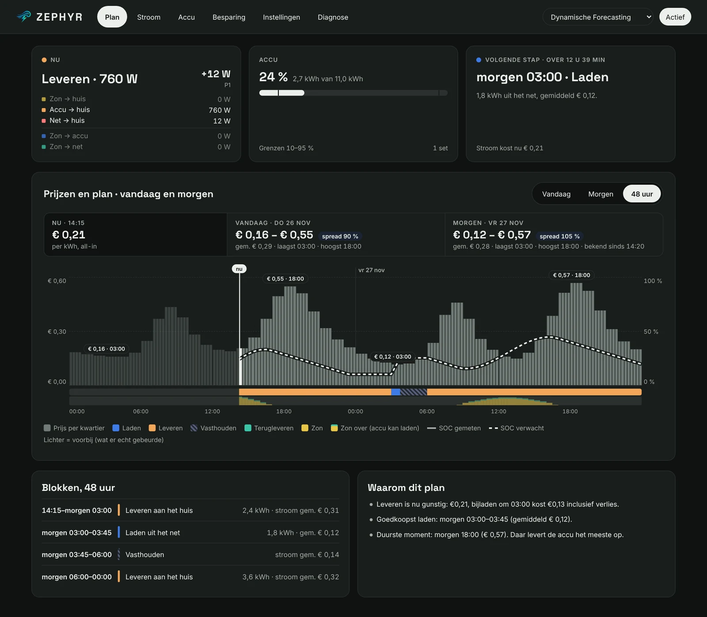

  <picture>
    <source media="(prefers-color-scheme: dark)" srcset="docs/logo-dark.png">
    
  </picture>

# ZEPHYR

*Zendure Energy Planning, Home Yield & Regulation*  
**Forecasting Tomorrow. Planning Today.**

[English](README.md)

**ZEPHYR** is een Home Assistant-integratie (HACS) voor thuisaccu's van Zendure. ZEPHYR praat rechtstreeks met je Zendure-set in je eigen netwerk (de lokale zenSDK-API, geen cloud), houdt je P1-meter op nul en plant per kwartier wanneer de accu laadt, vasthoudt of levert, op basis van dynamische stroomprijzen, de zonverwachting en wat je huis gewoonlijk verbruikt.

*Het scherm Plan (voorbeelddata): wat de accu nu doet, de prijzen van vandaag en morgen, het verwachte laadpercentage en in gewone taal waarom dit het plan is. Hier levert ZEPHYR aan het huis tijdens de dure avond, laadt het uit het net in de goedkoopste kwartieren van de nacht en dekt het de ochtend- en avondpiek van de volgende dag.*

> **Status: in ontwikkeling.** ZEPHYR werkt en wordt getest op echte installaties, maar is nog niet af. Er verandert nog van alles. Zie de [CHANGELOG](CHANGELOG.md) voor de wijzigingen.

## Wat het doet

**Stuurt de accu**
- **Nul op de meter:** volgt je P1-meter, laadt de accu met zonne-overschot en levert wat het huis verbruikt, zodat er zo min mogelijk naar of van het net gaat.
- **Dynamische Forecasting:** dezelfde regeling, gestuurd door een plan. ZEPHYR bepaalt per kwartier of de accu laadt (met zon of uit het net), de lading vasthoudt voor later, of levert.
- Daarnaast **Standby**, **Snel opladen** en **Snel ontladen**.
- **Schaduwmodus:** ZEPHYR kan eerst naast je huidige systeem meedraaien en alleen uitrekenen wat het zou doen, zonder de accu aan te sturen. Live sturen is één schakelaar.
- **Veiligheid voorop:** bij twijfel (geen meterdata, set offline, een ander systeem stuurt de set) gaat ZEPHYR naar 0 W. Stopt Home Assistant, dan gaat de accu eerst naar 0 W.

**Plant vooruit**
- Gebruikt de day-ahead-prijzen (Nord Pool) van vandaag en, zodra bekend, morgen; optioneel een prijsverwachting voor de dagen daarna.
- Gebruikt je zonverwachting (Solcast of de verwachting uit het Energie-dashboard).
- Leert je huishoudelijk verbruik per kwartier, voor werkdagen, weekenden en feestdagen.
- Laadt alleen uit het net als dat goedkoper is dan wachten, inclusief rondgangsverlies en slijtage van de accu.
- Houdt rekening met verbruik dat je niet uit de accu wilt halen (zoals verwarmen met de airco), apparaten die je inplant (wasmachine, droger, vaatwasser), een vakantiemodus en negatieve terugleverprijzen (dan kan het je omvormer begrenzen).

**Laat zien en legt uit**
- Een eigen paneel in de zijbalk van Home Assistant: **Plan**, **Stroom** (live stroomflows door je huis), **Accu** (laadpercentage, cellen, wat de accu per dag deed), **Besparing**, **Instellingen** en **Diagnose**. Nederlands en Engels, licht en donker.
- Houdt per kwartier een kostenlogboek bij: wat je betaalde, en wat je zonder accu of zonder zon had betaald.
- Houdt eigen energietellers bij voor de accu, met gaten gevonden en opgevuld.

## Installatie
1. In HACS: *Aangepaste repositories* → `https://github.com/cardinal808/ZEPHYR` toevoegen als type *Integratie*, daarna **ZEPHYR** installeren.
2. Herstart Home Assistant.
3. Meestal wordt je set automatisch gevonden (*Instellingen → Apparaten en diensten*). Anders voeg je **ZEPHYR** toe en vul je het IP-adres van de set in.
4. Open het paneel **ZEPHYR** in de zijbalk → *Instellingen* en kies je P1-meter, prijsbron en zonverwachting (er worden voorstellen getoond). ZEPHYR start in de schaduwmodus.

Vereisten: HEMS uit in de Zendure-app; Home Assistant 2026.1 of nieuwer.

## Ondersteunde sets en accu's
- Sets met de lokale zenSDK-API: SolarFlow 800, 800 Plus, 800 Pro, 1600 AC+, 2400 AC, 2400 AC+, 2400 Pro en 4000 AC+. Tot nu toe getest: 2400 Pro en 2400 AC+.
- Accu's worden herkend aan hun serienummer: AB1000, AB1000S, AB2000(S/X), AB3000X, AB3000L en de ingebouwde accu's van de 2400 Pro, 2400 AC+, 4000 AC+ en AIO 2400.
- Nieuwere modellen (800 AC+, 800 Pro 2, 3000/4000 Mix) en accu's (AB2000L, AB3000S, B6400) werken waarschijnlijk voor uitlezen, maar staan nog niet in de tabellen; met een diagnose-download kunnen we ze toevoegen.
- **Niet ondersteund** (geen lokale zenSDK-API): SolarFlow Hub 1200/2000, Hyper 2000, Ace 1500, AIO 2400 en SuperBase.
- Accu niet herkend? Home Assistant toont een reparatiemelding. Vul de capaciteit in via ZEPHYR → de set → *Opnieuw configureren*, en open graag een issue met de regel uit de melding.

## Herkomst
ZEPHYR is een nieuwe implementatie. Het bevat geen code of tekst uit andere Zendure-integraties of -pakketten. Waar andere projecten zijn geraadpleegd, is alleen hun gedrag vergeleken, nadat onze eigen specificatie was geschreven.

## Licentie
MIT, zie [LICENSE](LICENSE).
